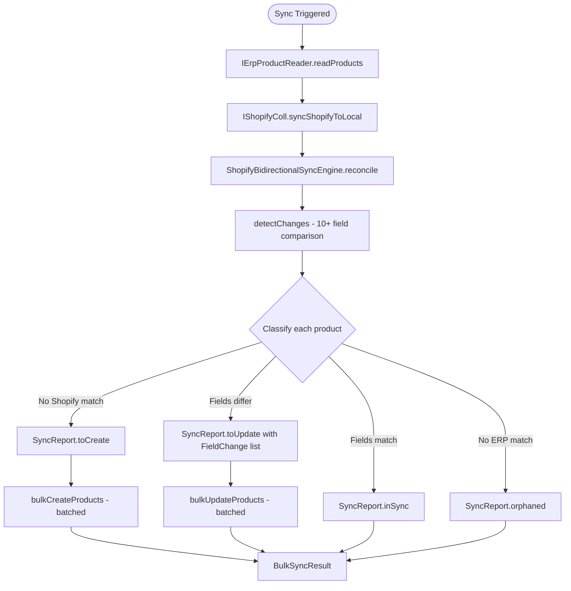
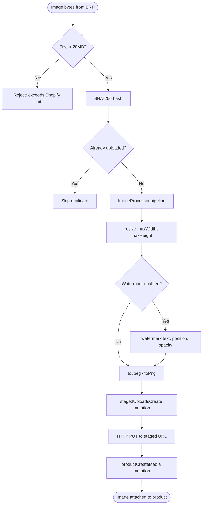
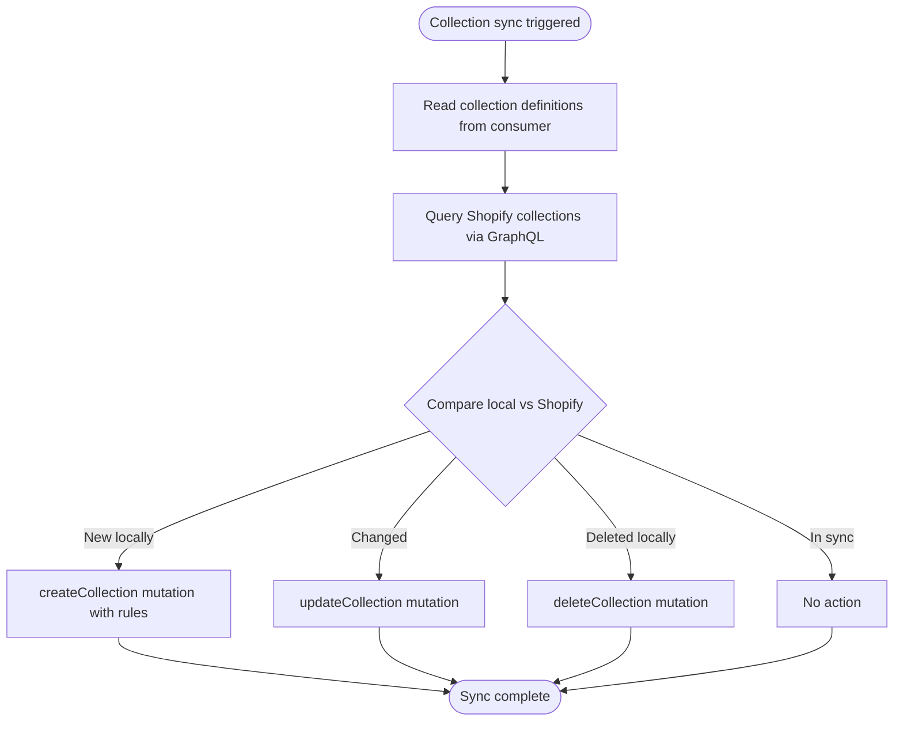
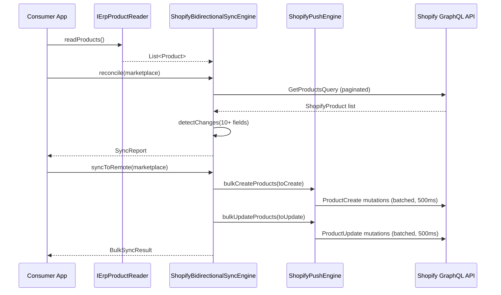
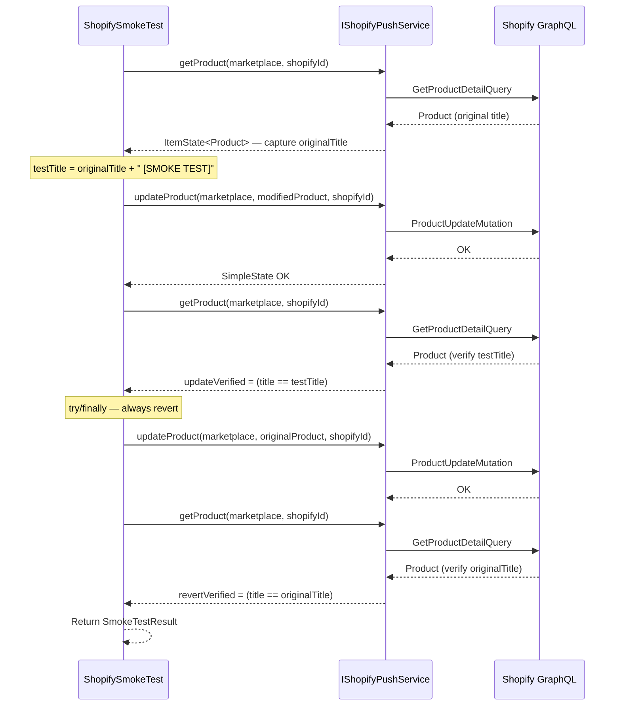
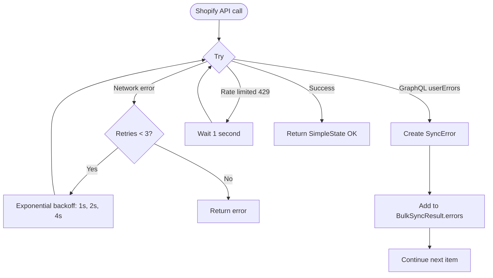

# FLOWCHART — FullShopifySync (FEATURE)

## 1. Core Processing Flow — Bidirectional Sync with Enhanced Diff

## 2. Image Processing Pipeline

## 3. Smart Collection Sync Flow

## 4. Consumer App Integration Sequence

## 5. Smoke Test — Round-Trip Verification

## 6. Error Handling

---

[← Index](../INDEX.md) · [BRIEF](BRIEF.md) · [SPEC](SPECIFICATION.md) · **FLOWCHART** · [API SURFACE](API_SURFACE.md) · [VIEWS](VIEW_MAP.md) · PLAN · TESTS · AUDIT
