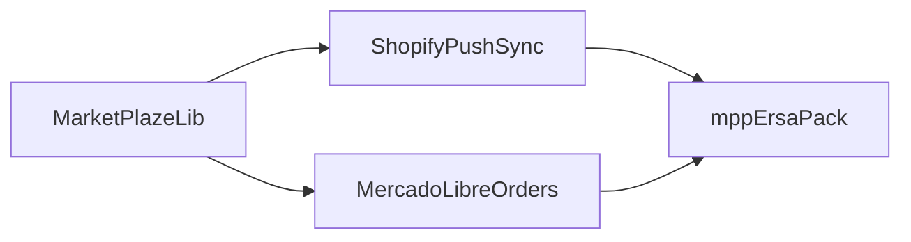

# Blueprints Index
**Updated**: 2026-03-27

## Active Modules & Libraries
| Name | Mode | Status | Phase | Owner | Notes |
|------|------|--------|-------|-------|-------|
| [MarketPlazeLib(MODULE)](MarketPlazeLib(MODULE)/BRIEF.md) | LIBRARY | ✅ Complete | — | @tfonrouge | Published v1.1.0 under `com.fonrouge.marketPlazeLib` |

## Active Bridges
| Bridge | Connects | Type | Status | Expiry Condition |
|--------|----------|------|--------|-----------------|
| [ShopifyPushSync(BRIDGE)](ShopifyPushSync(BRIDGE)/BRIEF.md) | commonLib ↔ shopifyLib | Permanent | ✅ Complete (22/22) | — |

## Active Features
| Feature | Module | Status | Owner | Notes |
|---------|--------|--------|-------|-------|
| [MercadoLibreOrders(FEATURE)](MercadoLibreOrders(FEATURE)/BRIEF.md) | mercadoLibreLib | 🔵 Planning | @tfonrouge | Order models + abstract coll + sync logic |

## Planned (blueprint only)
| Bridge | Connects | Type | Status | Expiry Condition |
|--------|----------|------|--------|-----------------|
| [MercadoLibreIntegration(BRIDGE)](MercadoLibreIntegration(BRIDGE)/BRIEF.md) | mercadoLibreLib ↔ ML API | Permanent | 🔵 Planning | — |
| [AmazonIntegration(BRIDGE)](AmazonIntegration(BRIDGE)/BRIEF.md) | amazonLib ↔ SP-API | Permanent | 🔵 Planning | — |

## Deprecated
| Name | Reason | Deprecated On |
|------|--------|---------------|

## Dependency Map

## Status Legend
| Icon | Meaning |
|------|---------|
| 🔵 Planning | Blueprint in progress, no code yet |
| 🟡 In Progress | Active development |
| 🟢 Stable | In production, blueprint aligned |
| ⚠️ Drifted | AUDIT.md flags misalignment |
| 🔴 Blocked | Waiting on external dependency |
| ✅ Complete | Shipped and verified |
| 🗄️ Deprecated | No longer active |