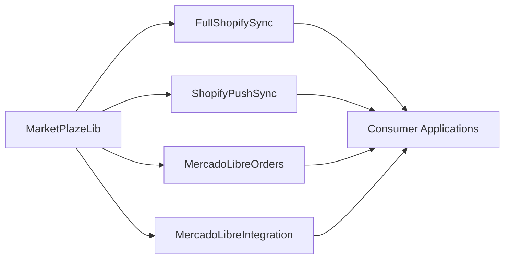

# Blueprints Index
**Updated**: 2026-07-22

## Active Modules & Libraries
| Name | Mode | Status | Phase | Owner | Notes |
|------|------|--------|-------|-------|-------|
| [MarketPlazeLib(LIBRARY)](MarketPlazeLib(LIBRARY)/BRIEF.md) | LIBRARY | ✅ Complete | v2.5.0 shipped | @tfonrouge | Published v2.5.0 under `com.fonrouge.marketPlazeLib` |

## Active Bridges
| Bridge | Connects | Type | Status | Expiry Condition |
|--------|----------|------|--------|-----------------|
| [ShopifyPushSync(BRIDGE)](ShopifyPushSync(BRIDGE)/BRIEF.md) | commonLib ↔ shopifyLib | Permanent | ⚠️ Drifted (library 22/22 complete; consumer never wired — see AUDIT.md) | — |
| [MercadoLibreIntegration(BRIDGE)](MercadoLibreIntegration(BRIDGE)/BRIEF.md) | mercadoLibreLib ↔ MercadoLibre API | Permanent | 🟡 ACTIVE (push service shipped 2026-07-03, 9/9 library tasks; not STABLE until a consumer wires it, see LEDGER D5) | — |

## Active Features
| Feature | Module | Status | Owner | Notes |
|---------|--------|--------|-------|-------|
| [FullShopifySync(FEATURE)](FullShopifySync(FEATURE)/BRIEF.md) | shopifyLib + commonLib | ✅ Complete | @tfonrouge | v2.3.0+v2.4.0+v2.5.0: collection CRUD, image pipeline, diff engine, bulk ops, smoke test, mutation deprecation cleanup |
| [MercadoLibreOrders(FEATURE)](MercadoLibreOrders(FEATURE)/BRIEF.md) | mercadoLibreLib | 🟡 In Progress | @tfonrouge | Model + abstract coll shipped (commit `7df6b3f`); TEST_PLAN + AUDIT pending |

## Deferred (blueprint only — no active development)
| Bridge | Connects | Type | Status | Reactivation Trigger |
|--------|----------|------|--------|---------------------|
| [AmazonIntegration(BRIDGE)](AmazonIntegration(BRIDGE)/BRIEF.md) | amazonLib ↔ SP-API | Permanent | ⏸️ Deferred | Consumer registers SP-API access + LWA/STS flow; only BRIEF.md exists, 5/6 BRIDGE artifacts pending |

## Deprecated
| Name | Reason | Deprecated On |
|------|--------|---------------|

## Dependency Map

## Status Legend
| Icon | Meaning |
|------|---------|
| 🔵 Planning | Blueprint in progress, no code yet |
| 🟡 In Progress | Active development |
| 🟢 Stable | In production, blueprint aligned |
| ⚠️ Drifted | AUDIT.md flags misalignment |
| 🔴 Blocked | Waiting on external dependency |
| ⏸️ Deferred | Blueprint exists but not staffed; awaiting reactivation trigger |
| ✅ Complete | Shipped and verified |
| 🗄️ Deprecated | No longer active |