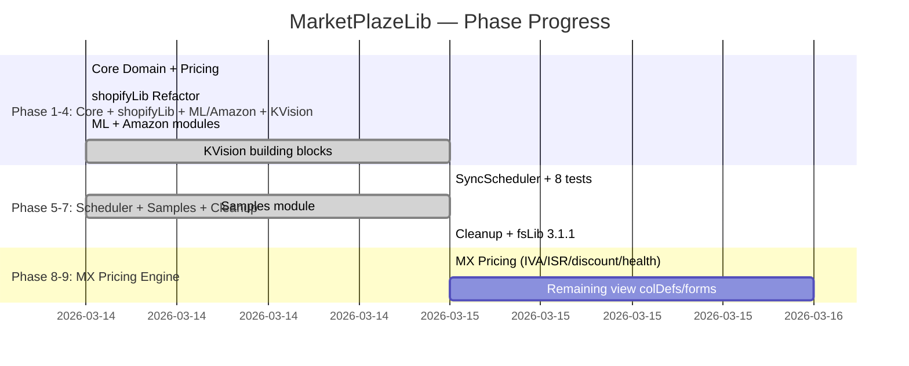

# MarketPlazeLib — Traceability Matrix

**Module**: MarketPlazeLib
**Last Updated**: 2026-03-15
**Overall Status**: 95% complete (Phase 9 pending: view building blocks)

## Timeline (Gantt)

## Requirement Traceability

| REQ-ID | Description | Phase | Status | Test ID |
|--------|-------------|-------|--------|---------|
| FR-01 | Money value class | 1 | Done | TEST-001..010 |
| FR-02 | Marketplace with IVA/ISR rates | 1,8 | Done | TEST-012 |
| FR-03 | Product with presentations | 1,8 | Done | TEST-014 |
| FR-04 | MarketplaceListing with discount | 1,8 | Done | TEST-013 |
| FR-05 | CostStructure model | 1 | Done | TEST-011 |
| FR-06 | CostBreakdown with taxes + health | 1,8 | Done | TEST-011..014 |
| FR-07 | MarketplaceComparator | 1,8 | Done | TEST-017 |
| FR-08 | PriceSuggester min price | 1,8 | Done | TEST-018, TEST-019 |
| FR-09 | PriceSuggester competitive | 1 | Done | TEST-020 |
| FR-10 | IMarketplaceSync interface | 1 | Done | — |
| FR-11 | SyncScheduler | 5 | Done | TEST-021..028 |
| FR-12 | Abstract Coll classes | 1 | Done | — |
| FR-13 | data object CommonContainers | 1,7 | Done | — |
| FR-14 | Typed filter classes | 1 | Done | TEST-030..043 |
| FR-15 | KVision column definitions | 4 | Done | — |
| FR-16 | Off-canvas filter views | 4 | Done | — |
| FR-17 | Form builders | 4 | Done | — |
| FR-18 | Shopify pull sync | 2 | Done | TEST-029 |
| FR-19 | @ShopifyField validation | 2 | Done | TEST-029 |
| FR-20 | MercadoLibre/Amazon hooks | 3 | Done | — |
| FR-21 | Shipping tier resolution | 8 | Done | TEST-015 |
| FR-22 | Health level classification | 8 | Done | TEST-016 |
| FR-23 | Product presentations | 8 | Done | TEST-014 |

## Milestone Tracker

| Milestone | Planned | Actual | Delta |
|-----------|---------|--------|-------|
| v1.0.0 initial release | 2026-03-15 | 2026-03-15 | 0 |
| v1.1.0 ShopifyPushSync | TBD | — | — |

## Open Issues

| Issue | Impact | Target |
|-------|--------|--------|
| Phase 9: colDef/form updates for new fields (ivaRate, discount, health, presentations) | Low — cosmetic, consuming app can add its own | Next session |

---
[← Index](../INDEX.md) · [BRIEF](BRIEF.md) · [SPEC](SPECIFICATION.md) · [FLOWCHART](FLOWCHART.md) · [API SURFACE](API_SURFACE.md) · [VIEWS](VIEW_MAP.md) · [PLAN](IMPLEMENTATION_PLAN.md) · [TESTS](TEST_PLAN.md) · **MATRIX** · [AUDIT](AUDIT.md)
