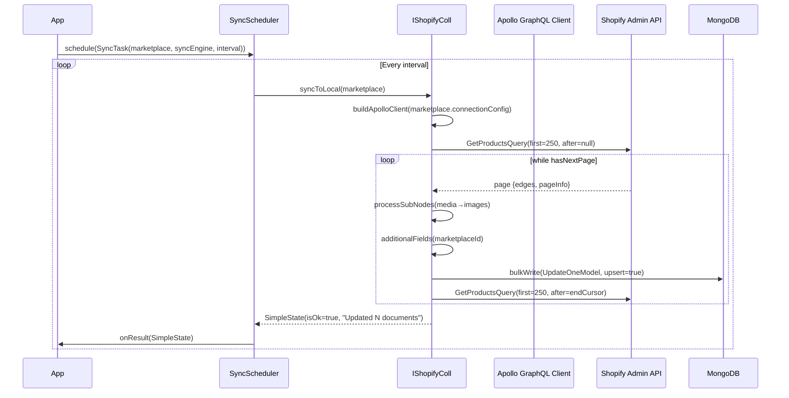
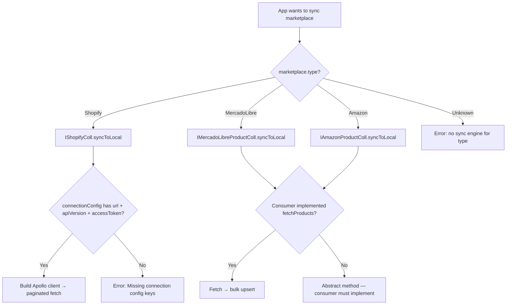
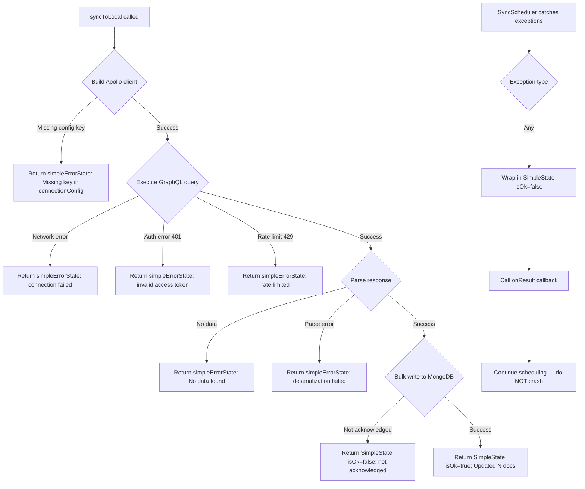
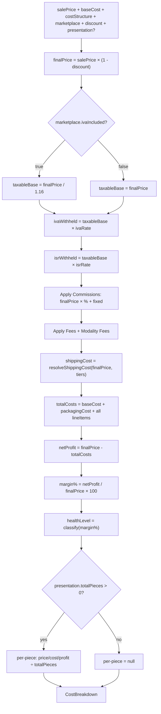
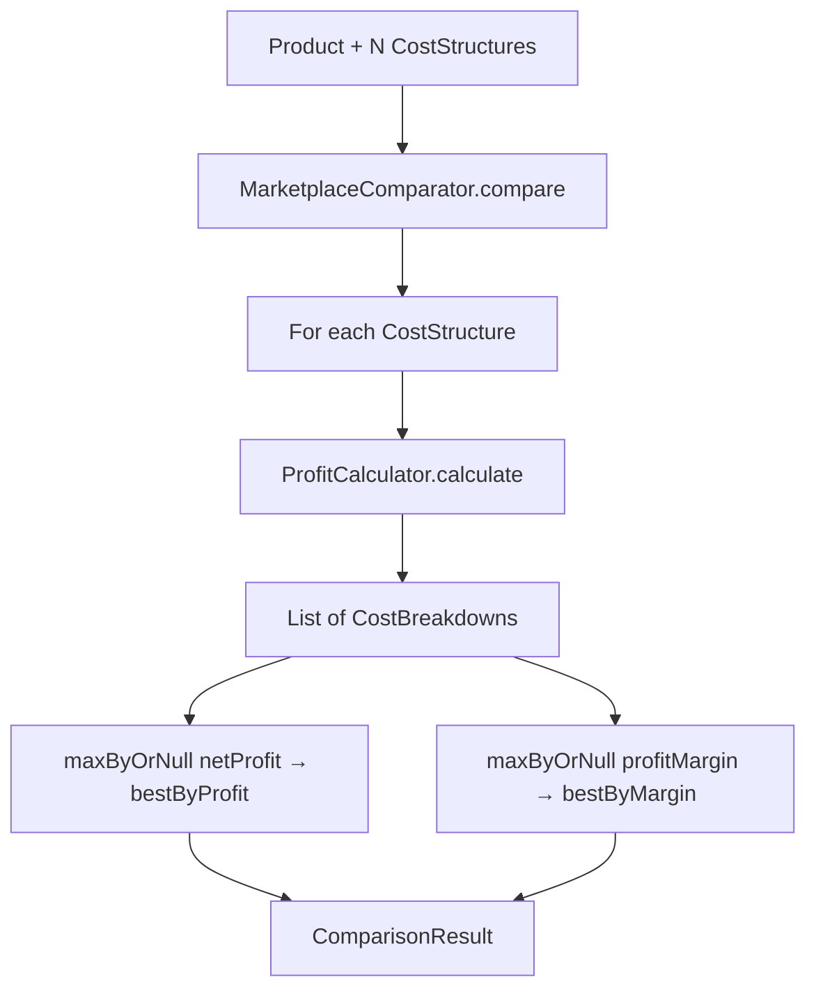
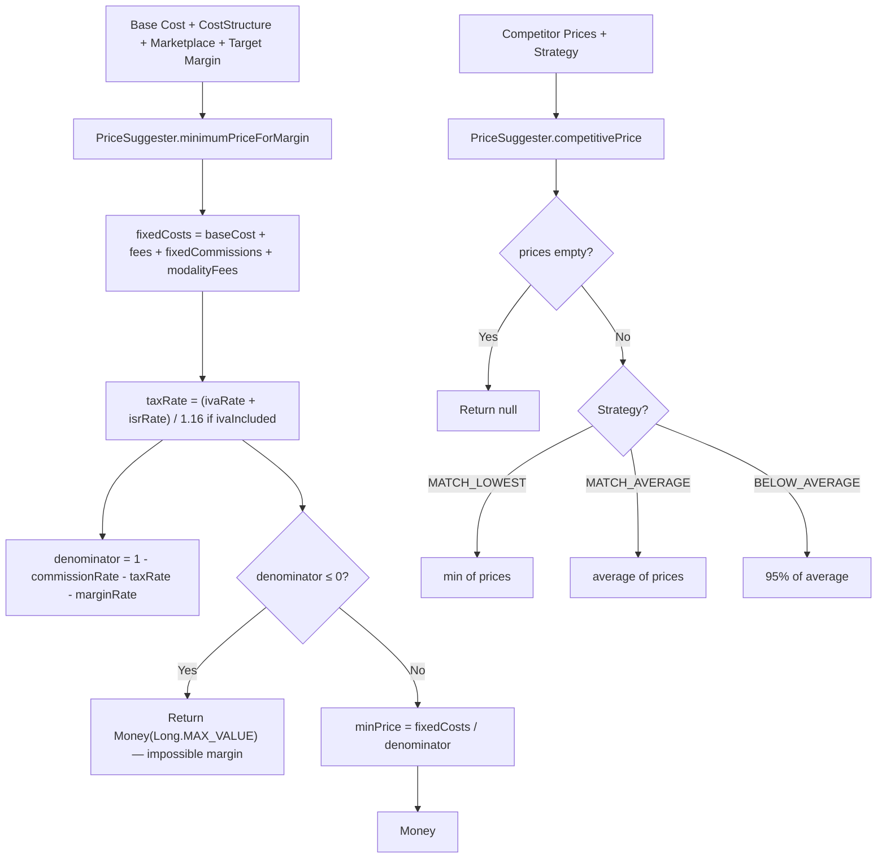
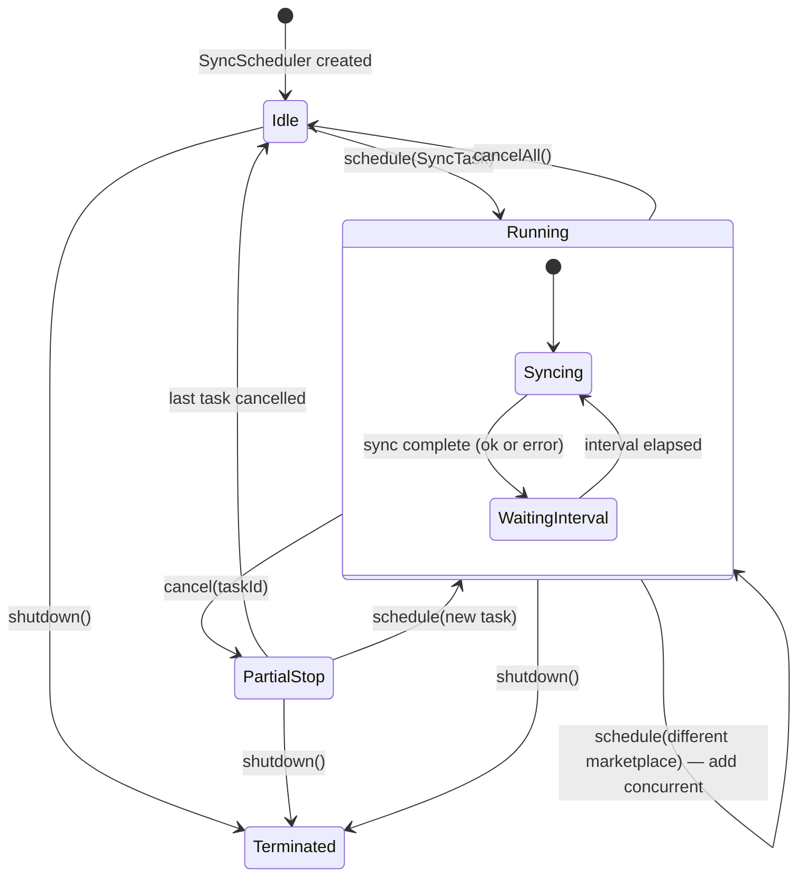

# MarketPlazeLib — Flowcharts

## 1. Happy Path: Shopify Pull Sync

## 2. Decision Tree: Sync Engine Selection

## 3. Exception Handling: Sync Failures

## 4. Profit Calculation Flow (with MX taxes)

## 5. Marketplace Comparison Flow

## 6. Price Suggestion Flow

## 7. SyncScheduler Lifecycle

