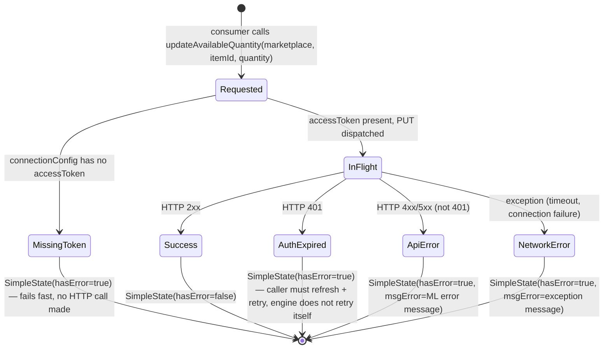
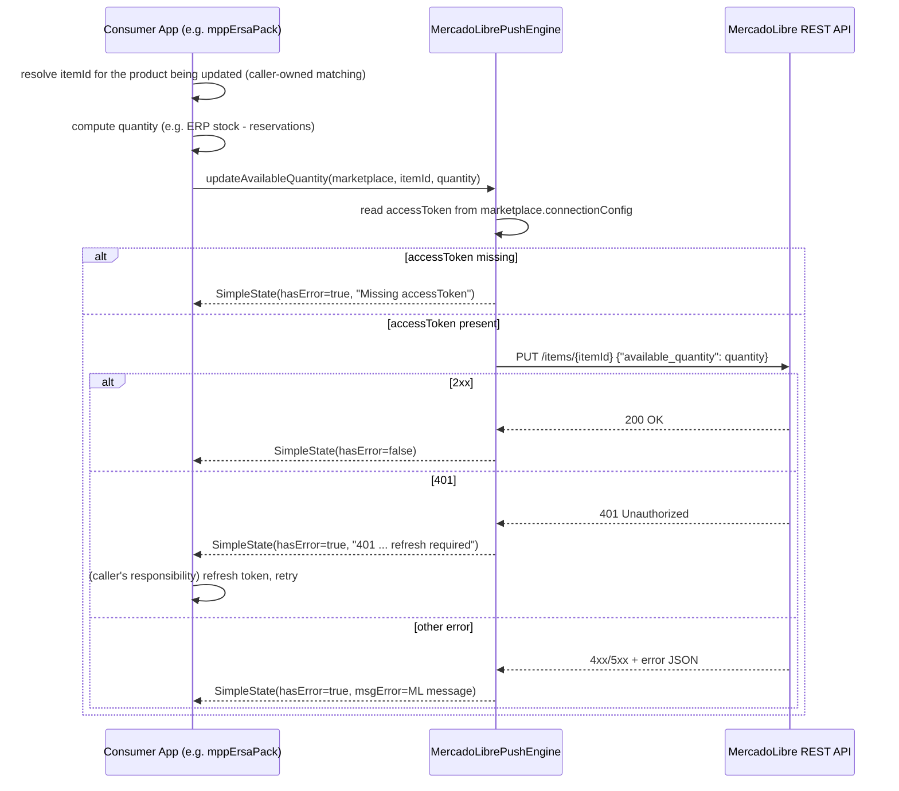

# MercadoLibreIntegration — Entity Descriptor

## Entity Overview

No new persisted entity. This bridge adds a **service operation** (`IMercadoLibrePushService.updateAvailableQuantity`) over the existing `Marketplace` entity — it does not introduce a new `BaseDoc`, container, or collection. `MercadoLibreProduct` (existing entity, pull-side) is unchanged.

The state machine below models the *operation lifecycle* of a single push call — not an entity's persisted state — since there is no entity to track.

---

## State Machine: Push Operation Lifecycle

## Business Rules

- BR-01: The system SHALL update a single MercadoLibre item's `available_quantity` via `PUT https://api.mercadolibre.com/items/{itemId}` — the global API base, not `.com.mx` (consistent with the consumer's existing read-side client and its documented rationale for rejecting the regional host).
- BR-02: The system SHALL authenticate with `Bearer {accessToken}` sourced from `Marketplace.connectionConfig["accessToken"]`. The system SHALL NOT attempt to refresh an expired token itself.
- BR-03: On HTTP 401 the system SHALL return a `SimpleState` with `hasError=true` and a message identifying it as an auth failure, without retrying. Retry-after-refresh is the caller's responsibility.
- BR-04: On any other non-2xx response the system SHALL surface MercadoLibre's own error message (`message` or `error` field from the JSON error body) in `SimpleState.msgError`, not just the HTTP status code.
- BR-05: The system SHALL NOT perform partial/batched updates — MercadoLibre's REST API has no documented bulk stock-update endpoint (unlike Shopify's GraphQL `inventorySetQuantities`); each call updates exactly one item. Callers needing to update N items make N calls.
- BR-06: The system SHALL close the underlying HTTP client after every call (no connection reuse across calls) — matches the existing `MercadoLibreApiClient` per-call client lifecycle in mppErsaPack.

## Data Model

No new fields on any entity. Reuses:

| Entity | Field | Used as |
|--------|-------|---------|
| `Marketplace` | `connectionConfig["accessToken"]` | Bearer token for the PUT request |
| — | `itemId: String` (method parameter, not a field) | MercadoLibre item id (e.g. `MLM2801064685`) — caller is responsible for resolving this from whatever SKU/Clave matching scheme it uses; out of scope for this bridge |
| — | `quantity: Int` (method parameter) | New `available_quantity` value; caller computes this (e.g. from ERP stock minus reservations) |

---

## Integration Flow

## Actor Matrix

| Actor | Call updateAvailableQuantity | Resolve itemId | Refresh expired token |
|-------|------------------------------|-----------------|------------------------|
| Consumer App (mppErsaPack orchestration) | Trigger | Owns (out of scope here) | Owns (out of scope here) |
| `MercadoLibrePushEngine` | Execute | — | — |
| MercadoLibre REST API | Respond | — | — |

---
[← Index](../INDEX.md) · [BRIEF](BRIEF.md) · **ENTITY** · [CONTRACTS](SERVICE_CONTRACTS.md) · [VIEWS](VIEW_MAP.md) · [ORDER](IMPLEMENTATION_ORDER.md) · [AUDIT](AUDIT.md) · [LEDGER](LEDGER.md)
