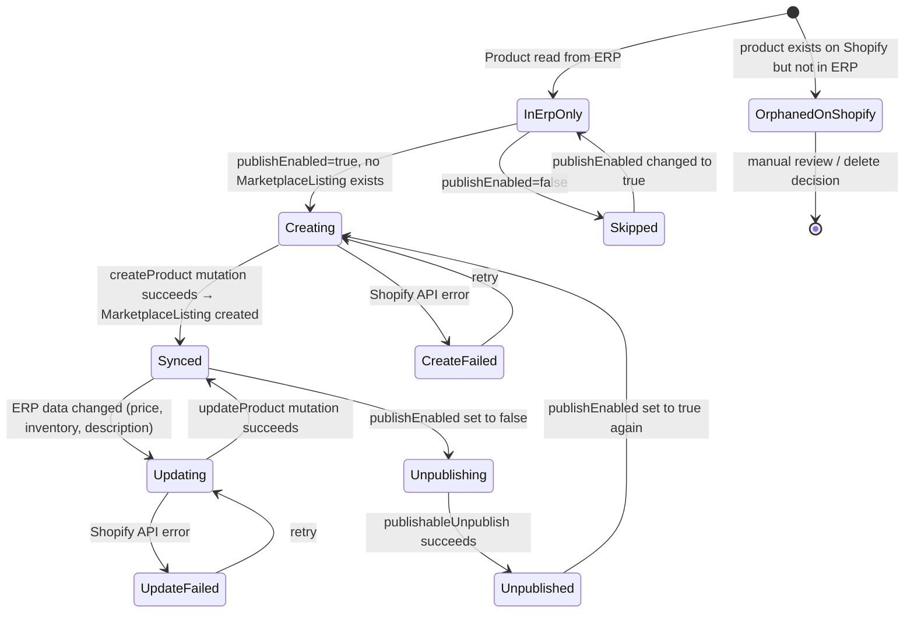
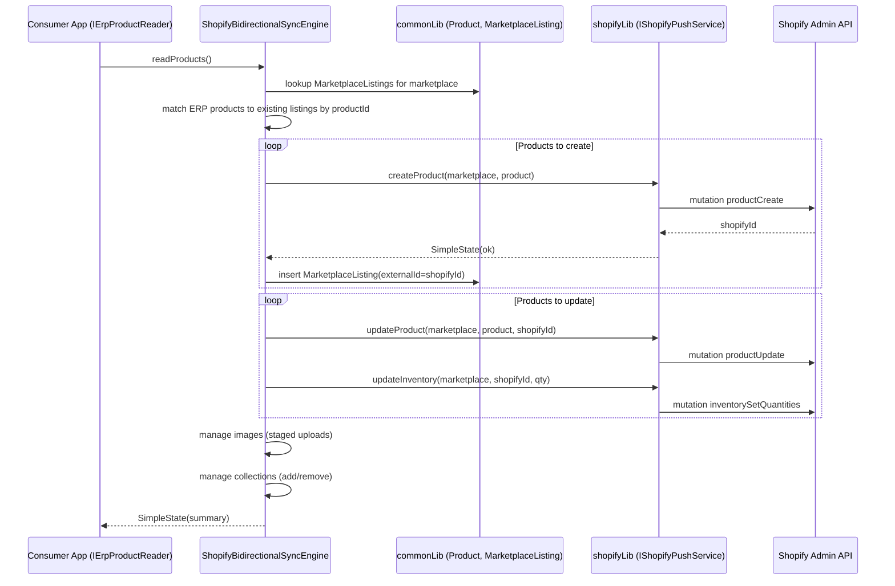

# ShopifyPushSync — Entity Descriptor

## Entity Overview

### ShopifyCollection
Represents a Shopify product collection (manual or automated). Used to organize products into browsable groups on the storefront. Synced bidirectionally — pulled from Shopify and managed via mutations.

### Product (enriched — existing entity)
The `Product` entity in commonLib is enriched with ERP-facing attributes needed for marketplace publishing: ERP source ID, price lists, inventory quantity, rich description, publish control, tags, weight, barcode, SEO metadata.

---

## State Machine: Product Sync Lifecycle

## Business Rules

- BR-01: The system SHALL read product data from the ERP via `IErpProductReader` — the library defines the interface, the consuming app implements it
- BR-02: The system SHALL only push products where `publishEnabled = true` to Shopify
- BR-03: The system SHALL create a `MarketplaceListing` record when a product is first pushed to Shopify, storing the Shopify product ID as `externalId`
- BR-04: The system SHALL update (not recreate) existing Shopify products when `MarketplaceListing.externalId` already exists
- BR-05: The system SHALL map `Product.priceLists` entries to Shopify variant prices based on price list name matching (e.g., a "Shopify" price list maps to the Shopify selling price)
- BR-06: The system SHALL update Shopify inventory quantities per location via `inventorySetQuantities` mutation
- BR-07: The system SHALL upload images via Shopify's staged uploads pattern (stagedUploadsCreate → HTTP POST → productCreateMedia)
- BR-08: The system SHALL support image deletion and reordering on Shopify products
- BR-09: The system SHALL support adding/removing products from Shopify collections
- BR-10: The system SHALL produce a `SyncReport` from `reconcile()` listing: products to create, products to update (with changed fields), orphaned Shopify products not in ERP
- BR-11: The system SHALL handle Shopify API rate limits gracefully — retry with backoff or report as partial failure, never crash
- BR-12: The `IMarketplaceSync` interface SHALL be extended with `syncToRemote(marketplace): SimpleState` for the push direction

## Data Model

### Product (enriched fields — added to existing entity)

| Field | Type | Constraint | Purpose |
|-------|------|-----------|---------|
| `erpSourceId` | `String?` | Optional | ID in ERP origin table |
| `priceLists` | `List<PriceListEntry>` | Default empty | Multiple price tiers |
| `inventoryQuantity` | `Int` | Default 0 | Available inventory |
| `descriptionHtml` | `String?` | Optional | Rich HTML description |
| `publishEnabled` | `Boolean` | Default false | Publish to marketplaces |
| `status` | `String` | "active"/"draft"/"archived" | Product lifecycle status |
| `tags` | `List<String>` | Default empty | Categorization tags |
| `weight` | `Double?` | Optional | Product weight |
| `weightUnit` | `String?` | "kg"/"g"/"lb"/"oz" | Weight unit |
| `barcode` | `String?` | Optional | GTIN/UPC/EAN |
| `seoTitle` | `String?` | Optional | SEO meta title |
| `seoDescription` | `String?` | Optional | SEO meta description |

### PriceListEntry (new value type)

| Field | Type | Purpose |
|-------|------|---------|
| `name` | `String` | "Retail", "Wholesale", "Shopify" |
| `price` | `Money` | Price amount in cents |
| `currencyCode` | `String` | ISO 4217 currency code (default "MXN") |
| `compareAtPrice` | `Money?` | Strikethrough/compare-at price |

### ProductVariant (enriched fields)

| Field | Type | Purpose |
|-------|------|---------|
| `compareAtPrice` | `Money?` | Variant compare-at price |
| `barcode` | `String?` | Variant barcode |
| `weight` | `Double?` | Variant weight |
| `weightUnit` | `String?` | Variant weight unit |
| `options` | `Map<String, String>` | Option values: "Color"→"Red" |

### ProductImage (enriched fields)

| Field | Type | Purpose |
|-------|------|---------|
| `position` | `Int` | Display order (0-based) |

### ShopifyCollection (new entity)

| Field | Type | Constraint | Purpose |
|-------|------|-----------|---------|
| `_id` | `StringId<ShopifyCollection>` | PK | Shopify collection GID |
| `marketplaceId` | `MarketplaceId` | FK | Which Shopify store |
| `title` | `String` | Required | Collection title |
| `handle` | `String` | Required | URL handle |
| `descriptionHtml` | `String?` | Optional | Collection description |
| `sortOrder` | `String` | Default "BEST_SELLING" | Sort order |
| `productsCount` | `Int` | Default 0 | Number of products |

### SyncReport (new value type)

| Field | Type | Purpose |
|-------|------|---------|
| `toCreate` | `List<Product>` | Products in ERP but not on Shopify |
| `toUpdate` | `List<SyncDiff>` | Products with changed fields |
| `orphaned` | `List<ShopifyProduct>` | Products on Shopify but not in ERP |
| `inSync` | `Int` | Count of products that match |
| `errors` | `List<SyncError>` | Failures during reconciliation |

---

## Integration Flow

## Actor Matrix

| Actor | Create Product | Read Product | Update Product | Sync to Shopify | Manage Collections |
|-------|---------------|-------------|----------------|-----------------|-------------------|
| ERP System (via IErpProductReader) | — | Read | — | — | — |
| ShopifyPushService | Create on Shopify | — | Update on Shopify | Execute | Manage |
| SyncEngine | — | Read local | — | Orchestrate | Orchestrate |
| App Admin (via consuming app) | — | View reports | — | Trigger | Configure |
